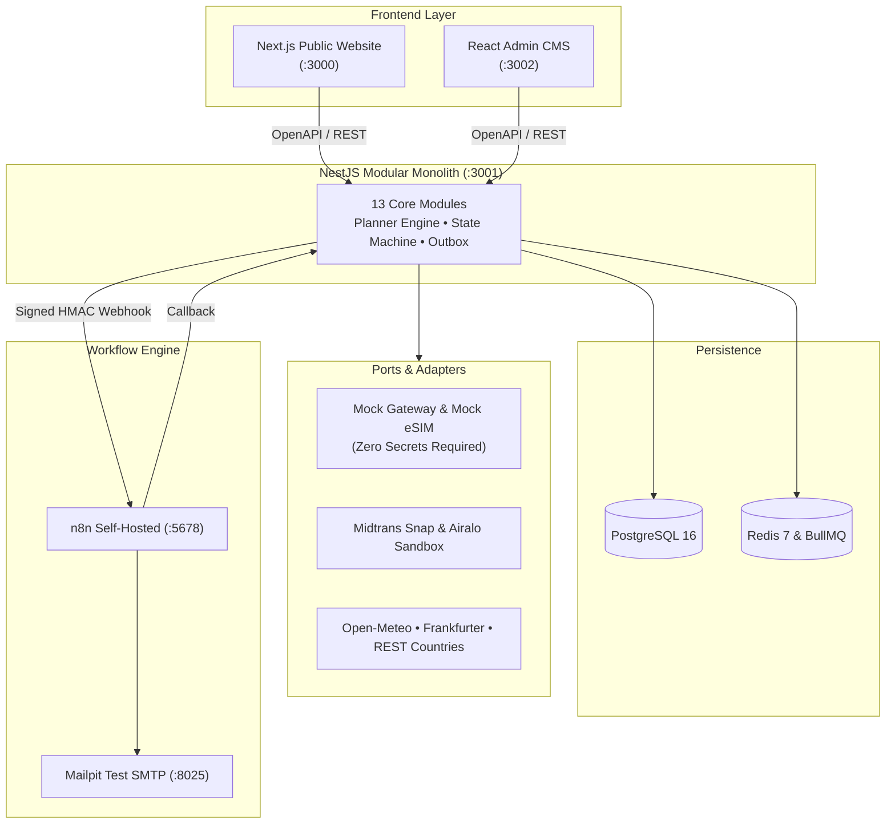

# JavaMifi Compass

> **"Plan your connection before you pack."**  
> *#AntiSusahSinyal*

---

## What It Is (In Three Sentences)
**JavaMifi Compass** transforms a traditional rental-WiFi and eSIM shop into a trip-centric connectivity platform where travelers plan first, buy second, and manage their whole journey in one place. It delivers a modern public Next.js website, a high-density React admin CMS, a modular NestJS API, PostgreSQL, Redis, and 10 self-hosted n8n automation workflows starting with a single `docker compose up`. The platform unifies digital eSIM provisioning and physical Pocket WiFi logistics into one verified order state machine that runs safe-by-default on mocks with zero required secrets.

---

## Key Features

### 🌐 Public Website (`apps/web`)
- **Trip Planner Wizard (W3, W11):** Deterministic, unit-tested recommendation engine comparing Pocket WiFi vs. eSIM vs. Physical SIM with transparent cost-per-person-per-day, break-even analysis, and group split cost calculator.
- **Compass Rasa Halal Dining (W12):** 20-destination halal dining explorer with a 5-tier fail-closed trust engine (`CERTIFIED`, `CLAIMED`, `OPTIONS`, `NOT_HALAL`, `UNKNOWN`), verbatim quote audit drawer, official certifier customs stamp (`HalalCustomsStamp`), dual currency prices with stale rate detection (`▲ Kurs >3 hari`), and combined connectivity + dining food budget.
- **Destination Readiness Card (W2):** Server-rendered pages featuring real-time weather (Open-Meteo), ECB currency exchange rate vs IDR (Frankfurter), and country facts (REST Countries v3.1) with curated tips (China VPN bypass notes).
- **Post-Purchase Trip Hub (W7):** One page per trip containing the boarding-pass style Trip Card, eSIM QR activation code, iOS/Android installation guides, 80% usage consumption meter, logistics return timeline, and top-up options.
- **eSIM Smartphone Checker (W4):** Searchable database of eSIM-compatible smartphone brands and models.
- **Cart & Sandbox Checkout (W5):** Server-side priced cart with promo codes (`ANTISUSAHSINYAL`, `HEMAT50K`) and interactive sandbox payment simulator.
- **Bilingual & Accessible (W9):** Indonesian and English message catalogs (`id.json`, `en.json`) with zero hardcoded user-facing strings.

### ⚙️ Admin CMS (`apps/admin`)
- **Executive Operations Dashboard (C12, C13):** Live KPI cards tracking gross revenue, devices in use, return deadlines, dead-letter automation events, false-halal rates (0.00%), and dining moderation queues.
- **Dining Moderation & Dispute Queue (C13):** Persistent dispute review with HMAC-SHA256 outbox dispatch to n8n and append-only audit trail logging.
- **Order Management & Payment Ledger (C7):** End-to-end order inspection with append-only financial ledger movements and order state machine transitions.
- **Device Fleet Management (C6):** Serial number tracking (JMF-WIFI-001 to 010), battery health indicators, physical inspection workflows, and deposit refund triggers.
- **Bilingual Content Editor (C2, C4):** Block-based editorial workflow with status transitions (`DRAFT` → `IN_REVIEW` → `PUBLISHED`) and version history.
- **Automation Console (C9):** Real-time execution logs for n8n workflows, webhook outbox monitoring, and one-click manual retry for failed runs.
- **Adapter Switches & Health (C10):** Dynamic runtime toggles between Mock and Live Sandbox adapters (Midtrans Snap & Airalo).
- **Immutable Audit Log (C11):** Append-only audit trail recording every state change and sensitive action.

### 🤖 Automation with n8n (`automation/n8n/`)
- Ten version-controlled workflows orchestrated via a **Transactional Outbox Pattern**:
  1. `01-order-fulfilment.json`: Provisions eSIM, emails Trip Hub QR, and dispatches chat alerts upon `order.paid`.
  2. `02-checkout-recovery.json`: 30-minute cart reminders and automated 24-hour expiration releasing reserved stock.
  3. `03-device-lifecycle.json`: Return reminders 2 days before due date and deposit refund processing.
  4. `04-usage-and-expiry-alerts.json`: Proactive alerts when data consumption reaches 80%.
  5. `05-ops-digest.json`: Daily 08:00 WIB operational digest to Slack, Telegram, or Mailpit.
  6. `06-content-publish.json`: Newsletter and marketing draft generation upon `article.published`.
  7. `07-support-intake.json`: Urgency keyword triage (`darurat`, `no signal`, `airport`) and contaminant safety escalation (`pork`, `babi`, `mirin`, `expired`) upgrading tickets to `CRITICAL_SAFETY`.
  8. `08-error-handler.json`: Captures workflow failures into the dead-letter log.
  9. `09-dining-enrichment.json`: Webhook-driven LLM extraction of verbatim halal certificates and menu evidence with signed HMAC verification.
  10. `10-dining-concierge-chat.json`: Natural language dietary request parser that converts traveler chat into structured API query parameters with zero free-text claims.

---

## System Architecture



### Architectural Principles
1. **Modular Monolith:** 13 bounded modules communicating through exported services and domain events.
2. **Ports and Adapters:** Mock implementations for payments, eSIM, email, and chat ensure the platform starts and tests without any external accounts.
3. **Single Source of Truth:** n8n orchestrates and alerts but **never touches the database directly**.
4. **Server-Side Pricing:** Clients send product IDs and quantities, preventing client-side price tampering.

---

## Quick Start (One Command)

### Prerequisites
- [Docker](https://www.docker.com/) & Docker Compose
- [Node.js](https://nodejs.org/) v20+ & [pnpm](https://pnpm.io/) v9+ (for local development)

### 1. Clone & Setup Environment
```bash
git clone https://github.com/javamifi/compass.git
cd compass
cp .env.example .env
```

### 2. Start All Services
```bash
docker compose up -d
```

### 3. Seed Database
```bash
pnpm db:seed
# or inside docker:
docker compose exec api npm run db:seed
```

### 4. Access URLs
| Application | URL | Credentials / Notes |
|---|---|---|
| **Public Website** | [http://localhost:3000](http://localhost:3000) | Traveler store, planner wizard & Trip Hub |
| **Admin CMS** | [http://localhost:3002](http://localhost:3002) | `admin@javamifi.com` / `Admin12345!` |
| **NestJS API & Swagger** | [http://localhost:3001/api/docs](http://localhost:3001/api/docs) | Complete OpenAPI interactive documentation |
| **n8n Automation Studio**| [http://localhost:5678](http://localhost:5678) | User: `admin` / Pass: `admin` |
| **Mailpit Email Inbox** | [http://localhost:8025](http://localhost:8025) | View sent QR codes and alerts |

---

## Demo Accounts

| Role | Email | Password | Permissions |
|---|---|---|---|
| **Super Admin** | `admin@javamifi.com` | `Admin12345!` | Full platform access, settings & audit log |
| **Logistics Lead**| `ops@javamifi.com` | `Ops12345!` | Device inventory, shipment queue & returns |
| **Traveler (Demo)**| `traveler@example.com`| `Traveler12345!` | Customer account with sample trip history |

---

## Configuration & Adapter Switches

Configure the platform in `.env`:

| Environment Variable | Allowed Values | Default | Purpose |
|---|---|---|---|
| `PAYMENT_GATEWAY_MODE` | `mock`, `midtrans_sandbox` | `mock` | Switch payment processing between simulated QRIS and Midtrans Snap |
| `ESIM_PROVIDER_MODE` | `mock`, `airalo_sandbox` | `mock` | Switch eSIM fulfillment between mock generator and Airalo API |
| `NOTIFICATION_MODE` | `mock`, `slack`, `telegram`| `mock` | Route notifications to Mailpit or external channels |
| `WEBHOOK_SECRET` | string (min 32 chars) | — | HMAC-SHA256 secret shared between API and n8n |

---

## Five-Minute Demo Script

1. **Trip Planning:** Navigate to [http://localhost:3000/id/planner](http://localhost:3000/id/planner). Select *Jepang*, 7 days, 4 travelers, 6 devices. Review the rule-based recommendation showing why Pocket WiFi wins over eSIM for groups, including break-even analysis and group split cost.
2. **Destination Readiness:** Open [http://localhost:3000/id/destinations/china](http://localhost:3000/id/destinations/china). Observe live weather from Open-Meteo, ECB Yuan exchange rate vs Rupiah, and the China VPN firewall advisory.
3. **Cart & Mock Payment:** Select a plan and proceed to checkout. Apply promo code `ANTISUSAHSINYAL` for a 15% discount. Click *Lanjut ke Pembayaran*. On the simulator, click **"Simulasi Bayar Berhasil (Settlement)"**.
4. **Automation & Trip Hub:** Check [Mailpit](http://localhost:8025) to view the automated email with the QR code and Trip Hub link. Open the Trip Hub to view the boarding-pass card, active data meter, logistics return timeline, and 400m Shibuya drop-off context.
5. **Admin Operations:** Log into [http://localhost:3002](http://localhost:3002). View the paid order, inspect the returned device in *Armada Modem WiFi* to trigger the deposit refund, check the 0.00% False-Halal moderation queue in Dashboard, and view the immutable record in *Audit Log*.
6. **Compass Rasa Halal Dining:** Navigate to [http://localhost:3000/id/destinations/japan/eat](http://localhost:3000/id/destinations/japan/eat). Test the fail-closed halal filter (CERTIFIED, CLAIMED, OPTIONS, NOT_HALAL, UNKNOWN). Inspect the perforated customs stamp with official certifier registration, verify Yen to IDR dual-pricing with stale rate detection, and review the combined connectivity + dining food budget schematic.

---

## Testing

Run unit, integration, and state machine tests:
```bash
# Run all tests across the monorepo
pnpm test

# Run pure planner recommendation engine tests
pnpm --filter @javamifi/api test:unit -- src/modules/planner/planner.engine.spec.ts

# Run hybrid order state machine tests
pnpm --filter @javamifi/api test:unit -- src/modules/orders/order.state-machine.spec.ts

# Run payment signature verification tests
pnpm --filter @javamifi/api test:unit -- src/modules/payments/payments.spec.ts

# Run dining pipeline & deterministic tier engine tests
pnpm --filter @javamifi/api test:unit -- src/modules/dining/dining-pipeline.spec.ts

# Run golden set evaluation & 0.00% false-halal quality gate
pnpm --filter @javamifi/api test:unit -- src/modules/dining/evaluation/golden-set.spec.ts
```

---

## Repository Structure

```
javamifi-compass/
├── apps/
│   ├── web/                     # Next.js App Router public website (bilingual, Tailwind)
│   ├── admin/                   # React + Vite dense data CMS (TanStack, Tailwind)
│   └── api/                     # NestJS modular monolith API (13 modules)
│       └── prisma/              # ~30 core PostgreSQL tables & comprehensive seeder
├── packages/
│   ├── shared/                  # Zod validation schemas, enums, money/date/crypto helpers
│   ├── ui/                      # Design tokens, signal motif, route lines & boarding pass card
│   ├── api-client/              # Typed API client wrapper
│   └── config/                  # Shared ESLint, i18n rules, and TypeScript configs
├── automation/
│   └── n8n/                     # 8 production-grade n8n workflow JSON exports
├── infra/
│   └── nginx/                   # Reverse proxy configuration
├── docs/                        # Architecture, PRD, Security, Automation & ADRs
├── docker-compose.yml           # PostgreSQL, Redis, Mailpit, n8n, API, Web, Admin
├── .env.example                 # Zero-secret environment template
└── README.md                    # Project documentation & demo guide
```

---

## License & Provider Terms
- **Open-Meteo:** Free for non-commercial use under CC BY 4.0. Commercial production deployment requires an enterprise license or swap to another weather adapter.
- **Frankfurter:** Free European Central Bank reference exchange rate API.
- **REST Countries:** Public open data API (v3.1).
- **Brand Assets:** JavaMifi brand styling and #AntiSusahSinyal motif are approximate properties inspired by public company profiles.
