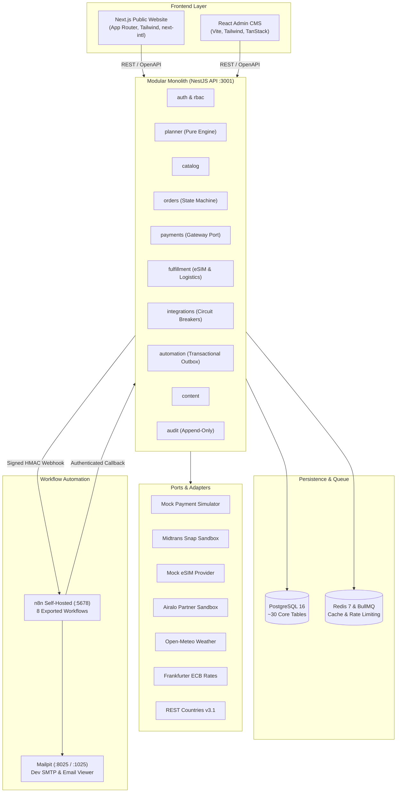

# JavaMifi Compass — System Architecture Documentation

JavaMifi Compass turns a traditional rental-WiFi and eSIM shop into a trip-centric connectivity platform: travelers plan first, buy second, and manage the entire journey in one Trip Hub.

---

## 1. Architectural Overview & Diagrams



---

## 2. Key Architectural Decisions

### 1. Modular Monolith
- **Decision:** One deployable NestJS service with strict module boundaries.
- **Why:** Avoids microservice network latency and DevOps complexity for this scope while keeping domain boundaries clean. Modules communicate exclusively through exported services or asynchronous outbox events, never by touching each other's database tables.

### 2. Ports and Adapters (Hexagonal Architecture)
- **Decision:** Every external integration (Payments, eSIM provisioner, Weather, Currency, Country data, Emails) sits behind a typed interface with a zero-secret mock and a live sandbox adapter.
- **Why:** Safe-by-default execution. Reviewers can run the entire platform with one `docker compose up` with zero API keys or external approvals.

### 3. Transactional Outbox Pattern
- **Decision:** Domain events (e.g. `order.paid`, `ticket.created`, `article.published`) are written inside the exact same database transaction as the business state change into the `outbox_events` table.
- **Why:** Guarantees zero lost events even if n8n or the network is momentarily down. A background worker delivers events with exponential backoff and HMAC-SHA256 signatures.

### 4. API as the Single Source of Truth
- **Decision:** n8n orchestrates and notifies, but **never reads or writes the database directly**.
- **Why:** Maintains relational integrity, validation schemas, and audit logging within the core API layer. n8n interacts solely through authenticated, signed API callbacks.

### 5. Server-Side Pricing
- **Decision:** The frontend never sends prices to the checkout API, only plan IDs, quantities, duration days, and promo codes.
- **Why:** Prevents client-side price tampering or forged transaction amounts.

---

## 3. Module Distribution Matrix

| Module | Owns | Talks To |
|---|---|---|
| `auth` | User accounts, argon2id hashing, rotating JWT sessions | `rbac`, `audit` |
| `rbac` | Roles, permissions, route guards | `auth` |
| `catalog` | Destinations, products, plans, promos, presets | `orders`, `planner` |
| `planner` | Rule-based recommendation engine (pure functions, no I/O) | `catalog`, `integrations` |
| `orders` | Hybrid order state machine, cart, reservation | `catalog`, `payments`, `fulfillment` |
| `payments` | Gateway port, HMAC & SHA-512 verification, ledger | `orders`, `automation` |
| `fulfillment` | Digital eSIM ICCID generation, device rentals & deposits | `orders`, `integrations` |
| `integrations`| Keyless public APIs (Weather, Currency, Countries) & circuit breakers | `planner`, `fulfillment` |
| `automation` | Transactional outbox worker, HMAC webhooks, n8n callbacks | all domain modules |
| `content` | Block pages, bilingual ID/EN content, versions | `audit` |
| `support` | Tickets, messages, automated urgency triage | `automation` |
| `audit` | Append-only immutable log (no UPDATE or DELETE) | all |
| `health` | Liveness, readiness, component probes | infrastructure |

---

## 4. Hybrid Order State Machine

```
              ┌──────────────────────────┐
              │          DRAFT           │
              └────────────┬─────────────┘
                           │ checkout()
              ┌────────────▼─────────────┐
        ┌─────┤     PENDING_PAYMENT      ├─────┐
        │     └────────────┬─────────────┘     │
        │                  │ webhook paid      │ expired (24h)
        │                  │                   │
        │             ┌────▼────┐              │
        │             │  PAID   │              │
        │             └────┬────┘              │
        │                  │ fulfill()         │
        │             ┌────▼────┐              │
        │             │FULFILLING│             │
        │             └──┬────┬─┘              │
        │                │    │                │
        │   [Digital eSIM]    [Physical Pocket WiFi]
        │                │    │                │
        │       ┌────────┘    └────────┐       │
        │       │                      │       │
        │  ┌────▼────┐            ┌────▼────┐  │
        │  │FULFILLED│            │ SHIPPED │  │
        │  └────┬────┘            └────┬────┘  │
        │       │                      │       │
        │       │                 ┌────▼────┐  │
        │       │                 │DELIVERED│  │
        │       │                 └────┬────┘  │
        │       │                      │       │
        │       └────────┬─────────────┘       │
        │                │                     │
        │           ┌────▼───┐                 │
        │           │ IN_USE │                 │
        │           └────┬───┘                 │
        │                │                     │
        │   [Digital eSIM]   [Physical WiFi]   │
        │       ┌────────┘   └─────────┐       │
        │       │                      │       │
        │       │              ┌───────▼───────┐
        │       │              │RETURN_PENDING │
        │       │              └───────┬───────┘
        │       │                      │
        │       │              ┌───────▼───────┐
        │       │              │   RETURNED    │
        │       │              └───────┬───────┘
        │       │                      │
        │       │              ┌───────▼───────┐
        │       │              │   INSPECTED   │
        │       │              └───────┬───────┘
        │       │                      │
        │       │              ┌───────▼───────┐
        │       │              │DEPOSIT_REFUND │
        │       │              └───────┬───────┘
        │       │                      │
        │       └────────┬─────────────┘
        │                │
        │          ┌─────▼─────┐
        │          │ COMPLETED │
        │          └───────────┘
        │
   ┌────▼──────┐   ┌───────────┐
   │ CANCELLED │   │  EXPIRED  │
   └───────────┘   └───────────┘
```
