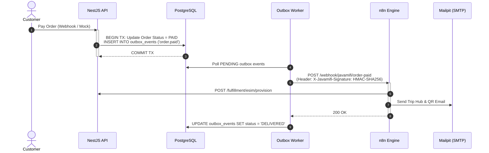

# JavaMifi Compass — Automation with n8n

Twelve production-grade n8n workflows orchestrate the order, device, dining intelligence, payment, and communication lifecycle. The API remains the single source of truth: **n8n orchestrates and notifies, but never reads or writes the database directly**.

---

## 1. The Twelve Automation Workflows

| # | Workflow Name | Trigger | Action & Responsibilities | Written Back to API |
|---|---|---|---|---|
| **01** | **Order Fulfilment** | `order.paid` event | Calls API to provision eSIM or queues physical Pocket WiFi shipment; emails Trip Hub QR code and install guide via Mailpit. | Fulfillment status, notification log |
| **02** | **Checkout Recovery** | Cron: every 15 min | Identifies orders pending for >30m and sends reminders; expires orders past 24 hours to release reserved stock. | Order expired, inventory released |
| **03** | **Device Lifecycle** | Cron: daily 09:00 WIB | Sends return reminders 2 days before rental due date; flags overdue units for ops escalation. | Rental status updates |
| **04** | **Usage & Expiry Alerts** | Cron: every 6 hours | Polls eSIM data usage quotas; fires alert email and top-up link when consumption crosses 80%. | Usage alert log |
| **05** | **Ops Daily Digest** | Cron: daily 08:00 WIB | Sends summary of shipments due today, active rentals, overdue units, and yesterday's revenue to ops team. | Digest execution record |
| **06** | **Content Publish** | `article.published` event | Triggers marketing campaign draft and prepares newsletter distribution. | Content distribution log |
| **07** | **Support Intake & Triage** | `ticket.created` event | Evaluates inquiry text for urgent keywords (`darurat`, `no signal`, `airport`) and escalates priority to URGENT. | Ticket priority |
| **08** | **Global Error Handler** | Any node failure | Captures workflow execution errors, notifies devops, and logs dead-letter events for CMS manual retry. | Dead-letter record |
| **09** | **Dining Enrichment Fan-Out** | Cron: daily 02:00 UTC | Fans out candidate dining venues to Gemini 3.8 Flash for verification against licensed registry sources and signs callback with HMAC-SHA256. | Halal tier updates, quote verification |
| **10** | **Dining Concierge Chat Assistant** | Webhook: WhatsApp/Telegram | Safe AI concierge providing strictly quote-grounded dining assistance and directions without computing deterministic tiers. | Concierge conversation log |
| **11** | **Voice-to-Halal & Place Enrichment** | Audio/Webhook | Ingests voice queries (Whisper/Speech API), queries licensed OpenStreetMap and Google Places APIs (conforming to API licensing & attribution policies, no raw HTML scraping), and enriches venue metadata. | Voice inquiry resolution |
| **12** | **Mock Payment Gateway Relay** | Webhook: Payment Simulator | Simulates asynchronous payment gateway notification webhooks (Midtrans/Stripe mock) with HMAC-SHA256 signature verification. | Payment status & settlement |

---

## 2. Transactional Outbox Pattern

---

## 3. Webhook Delivery & Signature Verification

All webhooks sent from the NestJS outbox worker to n8n carry security headers:
- `X-Javamifi-Event-Id`: Unique UUID of the outbox record
- `X-Javamifi-Event-Type`: e.g. `order.paid`, `ticket.created`
- `X-Javamifi-Timestamp`: UNIX timestamp string
- `X-Javamifi-Signature`: `HMAC_SHA256(timestamp + "." + payload, WEBHOOK_SECRET)`

Callbacks from n8n to the API verify the signature using `constantTimeCompare` to ensure authenticity.

---

## 4. Retries and Dead-Letter Queue

If an n8n webhook or network call fails:
1. **Exponential Backoff:** Retried up to 5 times (`delay = 2^retryCount` seconds).
2. **Dead-Letter State:** If 5 attempts fail, the record moves to `status = 'DEAD_LETTER'`.
3. **Manual Retry:** Operations staff can view failed runs in the Admin CMS Automation Console (`/automation`) and click **"Manual Retry"** to re-dispatch with a single click.
