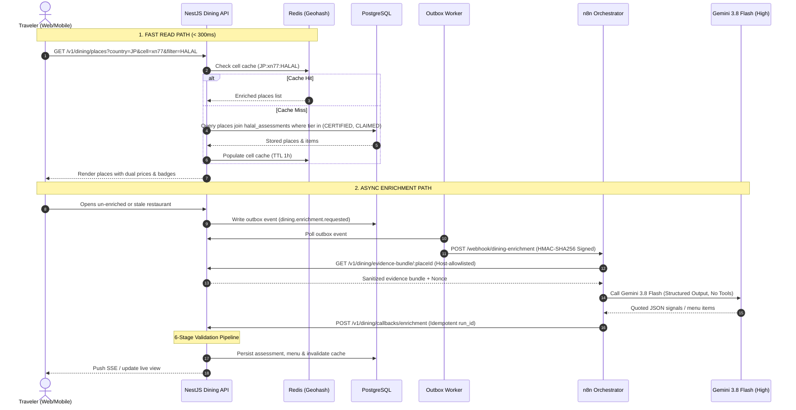

# JavaMifi Compass — AI-Powered Food Discovery Architecture & Design System

**Date:** 26 October 2026  
**Module:** `Compass Dining` (Compass Rasa) — Halal / Non-Halal Discovery, Menus & Dual-Currency Engine  
**AI Engine:** Gemini 3.8 Flash (High Thinking, Structured Output)  
**Design System:** Google Stitch *Transit Wayfinding* (Tactile Wayfinding Minimalism)  

---

## 1. Executive Summary & Architectural Fit

JavaMifi Compass transforms from a connectivity provider into an essential, end-to-end travel companion. The **AI-Powered Food Discovery** feature integrates into Compass without bloating the core connectivity runtime. It operates as a dedicated **Eat** tab inside both the **Destination Readiness Card** and the **Trip Hub**, while providing a top-bar exploration view across 20 simulated destinations.

```
┌────────────────────────────────────────────────────────────────────────┐
│                        TOP BAR DINING CONTROLS                         │
│  [ Halal | Non-Halal | All ]  [ Country: 🇯🇵 Japan ]  [ Radius: 2 km ]  │
└────────────────────────────────────┬───────────────────────────────────┘
                                     │
           ┌─────────────────────────┴────────────────────────┐
           ▼                                                  ▼
┌───────────────────────┐                          ┌─────────────────────┐
│  READ PATH (< 300ms)  │                          │ ASYNC ENRICHMENT    │
│  • Redis Cell Cache   │                          │ • Outbox Event      │
│  • Postgres (Enriched)│                          │ • HMAC Webhook      │
│  • IDR Math in Code   │                          │ • n8n + Gemini Flash│
│  • Fail-Closed Tiers  │                          │ • 6-Stage Validator │
└───────────────────────┘                          └─────────────────────┘
```

### Core Architectural Guardrails
1. **AI Extracts, Code Decides:** The LLM is strictly an information extraction engine with quote attribution. It never decides whether a restaurant is Halal, never performs currency arithmetic, and never invents missing facts.
2. **Ports and Adapters:** All external dependencies (`PlacesProvider`, `EvidenceProvider`, `HalalRegistryProvider`, `FxProvider`, `LlmProvider`) sit behind polymorphic interfaces with mock and live implementations.
3. **Transactional Outbox:** The API remains the sole system of record. Background enrichment events are committed inside database transactions; n8n never touches PostgreSQL directly.
4. **Licensed & Simulated Data:** Avoids scraping review sites. Uses licensed APIs and seeded fixtures for 20 countries, explicitly labeled "simulated data" in development and demo modes.

---

## 2. Brand Identity & Feature Logo Design

### 2.1 Design Philosophy: Transit Wayfinding
Grounded in **Tactile Wayfinding Minimalism** inspired by Tokyo Metro schematics, international airport boarding passes, and rail wayfinding:
- **Base Ground (`#EDF0EE`):** Cool, tactile architectural paper foundation. Never pure white.
- **Paper Surface (`#FFFFFF`):** Reserved exclusively as physical material for cards, menu tickets, and receipts.
- **Primary Ink (`#18215A`):** Deep Nila indigo anchoring headings, linework, and transit spines.
- **New Product Line Color (`line-dining`):**
  - **Fill:** `#059669` (Transit Emerald Jade)
  - **Stroke:** `#047857`
  - **Surface:** `#D1FAE5`
  - **Harmonizes with:** `#F27B2A` (WiFi Orange), `#4C97FF` (eSIM Blue), `#E96BB0` (SIM Pink), and `#18215A` (PRO Navy).

### 2.2 Feature Nomenclature & Typography
- **Feature Name:** **Compass Rasa** / **Compass Dining**
- **Wayfinding Moniker:** `STATION: EAT // KULINER`
- **Typography:**
  - **Barlow Condensed:** Bold transit station glyphs, status tags, price numerals, airport codes.
  - **Plus Jakarta Sans:** UI labels, menu item descriptions, explainer texts.
  - **JetBrains Mono:** Registry certificate numbers, minor-unit prices, timestamps, and evidence hashes.

### 2.3 Logo Geometry & SVG Specification
The logo combines a **Transit Station Interchange Bead** with a **Compass Waypoint Cloche / Fork Motif**:

```xml
<svg width="64" height="64" viewBox="0 0 64 64" fill="none" xmlns="http://www.w3.org/2000/svg">
  <!-- Outer Station Interchange Ring (28px equivalent scaled) -->
  <circle cx="32" cy="32" r="30" stroke="#18215A" stroke-width="4" fill="#FFFFFF"/>
  <!-- Dedicated Dining Line Ring -->
  <circle cx="32" cy="32" r="24" stroke="#059669" stroke-width="3" fill="#D1FAE5"/>
  <!-- Wayfinding Compass Star / Cloche Monogram -->
  <path d="M32 14V50M14 32H50" stroke="#18215A" stroke-width="2" stroke-dasharray="2 2"/>
  <!-- Modern Geometric Fork & Cloche Silhouette -->
  <path d="M22 26C22 20.4772 26.4772 16 32 16C37.5228 16 42 20.4772 42 26H22Z" fill="#18215A"/>
  <rect x="20" y="27" width="24" height="3" rx="1.5" fill="#047857"/>
  <circle cx="32" cy="14" r="2.5" fill="#059669"/>
  <!-- Central 'D' Transit Glyph -->
  <text x="32" y="44" font-family="Barlow Condensed" font-size="16" font-weight="700" fill="#18215A" text-anchor="middle">D</text>
</svg>
```

---

## 3. Five-Tier Halal Status Model (Fail-Closed)

Halal status is determined purely by deterministic application code, never by LLM output:

| Tier | Meaning | Rule Trigger (Deterministic Code) | UI Badge Style | Filter Visibility |
| :--- | :--- | :--- | :--- | :---: |
| **`CERTIFIED`** | Verified certificate from an accredited registry | Certificate registry match + valid expiration date + no pork/alcohol flags | Emerald Pill: `#D1FAE5` / `#047857` | Default (Halal) |
| **`CLAIMED`** | 1st-party declaration or ≥2 independent sources | Owner statement or verified directory evidence + no pork/alcohol flags | Cyan Pill: `#E0F2FE` / `#0284C7` | Default (Halal) |
| **`OPTIONS`** | Mixed kitchen with designated halal/seafood | Halal meat sourced OR dedicated pork-free cookware | Amber Pill: `#FEF3C7` / `#B45309` | Opt-in Only |
| **`NOT_HALAL`** | Pork or cooking alcohol confirmed on menu | Pork terms detected in menu or explicit non-halal declarations | Rose Pill: `#FEE2E2` / `#B91C1C` | Non-Halal Mode |
| **`UNKNOWN`** | Insufficient or conflicting evidence | Missing evidence, stale data (>180 days), or lexicon conflict | Sunken Grey: `#E1E6E3` / `#6B7570` | Hidden from Halal |

### Orthogonal Dietary Badges
- `SERVES_ALCOHOL` / `ALCOHOL_FREE`
- `PORK_ON_MENU` / `PORK_FREE`
- `CERTIFIER: [MUIS / JAKIM / BPJPH / JHF]`
- `VERIFIED: 2026-10-20`

---

## 4. Dual-Currency Pricing Engine & FX Resilience

### Minor Unit Storage Standard
- All monetary amounts are stored as **integers in minor currency units**:
  - `0 decimals:` JPY, KRW, VND (e.g. `¥1,200` stored as `1200`)
  - `2 decimals:` USD, EUR, SGD, MYR, SAR, AED, GBP (e.g. `SAR 45.50` stored as `4550`)
  - `3 decimals:` KWD, BHD, OMR, JOD
- **Conversion to IDR:**
  $$\text{IDR Amount} = \text{round}\left(\frac{\text{amount\_minor}}{10^{\text{decimals}}} \times \text{rate}_{\text{IDR}}, -2\right)$$
- Displays as `¥1,200 ≈ Rp 130.000` with rate timestamp and explicit disclaimer: *"Tarif indikatif per 26 Okt 2026; kurs kartu kredit dan penukaran fisik dapat berbeda."*

### Resilient FX Provider Chain
Because the European Central Bank (Frankfurter) excludes Gulf currencies (SAR, AED) and East Asian currencies (TWD, VND):
1. **Primary Provider:** Frankfurter ECB API (31 currencies, updated 16:00 CET).
2. **Secondary Fallback Provider:** Open Exchange / Central Bank of Indonesia (BI) cross-rates for SAR, AED, EGP, TWD, VND.
3. **Weekend & Holiday Resilience:** Caches Friday closing rates with explicit date tags.
4. **Circuit Breaker:** If no valid rate exists within 72 hours, IDR conversion hides gracefully with badge `"Kurs tidak tersedia"` rather than guessing.

---

## 5. End-to-End Workflow & System Interaction



---

## 6. Post-Model Deterministic Validation Pipeline

The 6-stage validation pipeline acts as the immutable safety net:

```
[ Raw Gemini Output ]
         │
         ▼
[ Stage 1: Zod Schema Validation ] ─────────► [ Fail: Drop & Retry ]
         │
         ▼
[ Stage 2: NFKC Quote Verification ] ──────► [ Fail: Revert Field to UNKNOWN ]
         │
         ▼
[ Stage 3: Multilingual Lexicon Scan ] ────► [ Match: Override to PORK_FOUND ]
         │
         ▼
[ Stage 4: Deterministic Tier Engine ] ────► [ Assign CERTIFIED / CLAIMED / etc. ]
         │
         ▼
[ Stage 5: Currency & Sanity Bands ] ──────► [ Outlier: Flag for Review ]
         │
         ▼
[ Stage 6: Security & Injection Check ] ───► [ Flag: Route to CMS Review Queue ]
```

1. **Zod Strict Schema Check:** Rejects unparseable or malformed payloads.
2. **NFKC Quote Verification:** Every claim must cite an exact verbatim substring from the raw evidence text (case, punctuation, and Unicode normalized).
3. **Multilingual Lexicon Scan:** Independent regex scan across 12 languages (Indonesian, English, Japanese, Chinese, Arabic, Turkish, Korean, etc.) for pork and alcohol derivatives (e.g., *butaniku, mirin, sake, lard, chashu, char siu*). Overrides any model omission.
4. **Deterministic Tier Assignment:** Pure TypeScript rules determine status based on verified evidence citations and certifier allow-lists.
5. **Price Sanity Bands:** Verifies currency matches the country (e.g. JPY in Japan) and checks price against dining category sanity thresholds (e.g. ramen between ¥500 and ¥3,500).
6. **Security Review Routing:** Any injection attempt, conflict, or validation anomaly flags the record for manual review in the CMS queue.

---

## 7. PostgreSQL Relational Data Model

Eight relational tables integrate seamlessly into the Compass database:

```
┌──────────────────┐       ┌──────────────────────┐       ┌────────────────────────┐
│     Place        │1     *│     PlaceSource      │       │     HalalEvidence      │
│──────────────────│───────│──────────────────────│       │────────────────────────│
│ id (PK)          │       │ id (PK)              │1     *│ id (PK)                │
│ placeRef         │       │ placeId (FK)         │───────│ placeSourceId (FK)     │
│ name             │       │ sourceType           │       │ quoteText              │
│ countryIso2      │       │ sourceUrl            │       │ language               │
│ latitude         │       │ attributionNotice    │       │ retrievedAt            │
│ longitude        │       │ ttlExpiresAt         │       └────────────────────────┘
│ geohashCell      │       └──────────────────────┘                   │
│ address          │                                                  │ 1..*
│ primaryPhone     │1                                                 ▼
│ googleRating     │       ┌──────────────────────┐       ┌────────────────────────┐
│ reviewCount      │───────│   HalalAssessment    │       │     DiningReport       │
└──────────────────┘       │──────────────────────│       │────────────────────────│
         │1                │ id (PK)              │       │ id (PK)                │
         │                 │ placeId (FK)         │       │ placeId (FK)           │
         │                 │ tier (Enum)          │       │ userId (FK, optional)  │
         │                 │ certifierName        │       │ reasonCode             │
         │                 │ certNumber           │       │ notes                  │
         │                 │ certExpiresAt        │       │ status (PENDING/RESOLV)│
         │                 │ modelVersion         │       └────────────────────────┘
         │                 │ promptVersion        │
         │                 │ assessedAt           │
         │                 └──────────────────────┘
         ▼1
┌──────────────────┐1     *┌──────────────────────┐
│   MenuSnapshot   │───────│       MenuItem       │
│──────────────────│       │──────────────────────│
│ id (PK)          │       │ id (PK)              │
│ placeId (FK)     │       │ menuSnapshotId (FK)  │
│ currencyIso4217  │       │ nameOriginal         │
│ languageCode     │       │ nameEn               │
│ snapshotDate     │       │ nameId               │
│ isCurrent        │       │ category             │
└──────────────────┘       │ sourceDescription    │
                           │ explainerEn          │
                           │ cautionHint          │
                           │ amountMinor (Int)    │
                           │ priceType            │
                           │ flags (JSONB)        │
                           └──────────────────────┘
```

---

## 8. Phased Delivery Roadmap & Quality Gates

| Phase | Milestone | Deliverables | Verification Gate |
| :---: | :--- | :--- | :--- |
| **P0** | **Domain Foundation & Read Path** | • Dining taxonomy, Zod schemas in `@javamifi/shared`<br>• FxProvider chain with Gulf fallback in `@javamifi/api`<br>• Seeded fixtures across 20 countries<br>• Top bar segmented control and responsive place cards in `@javamifi/web` | Sub-300ms read path; 20 countries render dual prices correctly |
| **P1** | **Extraction Adapters & n8n Pipeline** | • Gemini 3.8 Flash high-thinking adapter<br>• 6-stage post-model validation engine<br>• n8n enrichment workflow JSON with HMAC-SHA256 signed callbacks<br>• Unit tests for quote verification and lexicon scanners | 100% pass on synthetic injection benchmarks; zero false halal outputs |
| **P2** | **Live AI Pilot & Golden-Set Evaluation** | • Connect live Gemini API with thinking high<br>• Evaluate 100 labeled venues across 5 target countries (Japan, China, Saudi Arabia, Singapore, UK)<br>• Review and tune prompt constraints | **Golden-set gate:** 0 false-halal classifications, >95% quote verification accuracy |
| **P3** | **Full Rollout & CMS Governance** | • 20 simulated countries fully enriched<br>• CMS Review Queue in `@javamifi/admin` for flagged items and reports<br>• User "Report Incorrect Info" dispute workflow | Operations can inspect, override, and audit every tier assignment |
| **P4** | **Hardening & Budgets** | • Rate-limiting and daily enrichment token budget guard<br>• Kill switch feature flag<br>• Security audit checklist update | Budget guard auto-halts enrichment when cap is reached |
